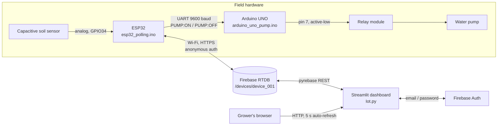

# AgriSmart: ESP32 Smart Irrigation

Closed-loop soil-moisture irrigation for small farms and gardens: an ESP32 measures the soil, an Arduino UNO switches the pump, Firebase Realtime Database carries state both ways, and a Streamlit dashboard lets the grower watch, control and automate watering from any browser.


Status: college IoT project (Team 8), demonstrated end-to-end on real hardware.

## Overview

**Problem.** Manual irrigation is guesswork: growers water on a schedule rather than on soil condition, so crops are either over-watered (wasting water and electricity, promoting root rot) or under-watered during hot spells. Nobody wants to walk to the field to check a sensor or flip a pump switch.

**Solution.** AgriSmart puts a capacitive soil-moisture probe on an ESP32 that publishes readings to Firebase every few seconds and polls the same database for commands. An Arduino UNO, wired to the ESP32 over UART, drives the pump relay. A Streamlit web dashboard authenticates the grower with Firebase email/password, shows the live reading, lets them toggle the pump manually, or hand control to an on-device **auto mode** that opens the pump below a low threshold and closes it above a high threshold (hysteresis, so the relay never chatters). The dashboard also keeps a history, computes pump runtime, offers a rule-based watering recommendation and raises browser notifications when the soil leaves the safe band.

**Context.** Built as a college IoT course project by Team 8. The repository holds the firmware for every stage of the build (an ESP8266/Blynk warm-up, a Firebase-streaming ESP32 version, and the final polling ESP32 + UNO pair), the Python dashboard, the presentation and a sample session log.

## Key features

- **Live soil-moisture telemetry** — ESP32 averages five 12-bit ADC samples from GPIO34, maps 4095..0 to 0..100 % and writes `/devices/device_001/sensors/moisture` every 4 s.
- **Remote pump control** — dashboard writes `actuators/pump/status`; the ESP32 polls it every 6 s and forwards `PUMP:ON` / `PUMP:OFF` over `Serial2` to the UNO, which drives an active-low relay on pin 7.
- **On-device auto mode with hysteresis** — pump turns ON when moisture `< thresholds/low` and OFF when `>= thresholds/high` (defaults 30 % / 70 %), evaluated every 5 s on the ESP32 so it keeps working if the dashboard is closed.
- **Threshold tuning from the browser** — sidebar sliders (low 10–50 %, high 50–90 %) persist to `settings/thresholds`; the device picks them up on its next poll.
- **Email/password login** — Firebase Authentication through `pyrebase`, with Sign In / Register tabs and friendly error mapping (`EMAIL_EXISTS`, `WEAK_PASSWORD`, `INVALID_LOGIN_CREDENTIALS`).
- **History and analytics** — Plotly two-row chart (moisture spline with threshold lines, pump ON/OFF step trace coloured by AUTO/MANUAL trigger) over a selectable window from 1 hour to 1 week, plus a condition-distribution donut.
- **Pump runtime accounting** — pairs ON/OFF events in `/history/device_001/pump` to total running time for the selected window, including a currently-running pump.
- **Alerts** — browser `Notification` API pop-ups and an in-app alert log (stored under `/notifications/device_001`) when moisture drops below 30 % or rises above 70 %, with a 5-minute per-type cooldown to avoid spam.
- **Rule-based recommendation card** — six moisture bands (critical, urgent, suggested, optimal, good, warning) with a plain-language watering suggestion.
- **Device liveness indicator** — Online / Latency / Offline computed from `info/lastSeen` (written by the streaming firmware's 30 s heartbeat).
- **Resilient firmware** — Wi-Fi watchdog every 15 s with reconnect and `ESP.restart()` fallback; status-LED blink codes for boot, Wi-Fi, Firebase and pump events.

## Architecture



| Component | Responsibility | Key files |
|---|---|---|
| ESP32 (final) | Sample sensor, publish moisture, poll commands/settings, run auto mode, drive UNO over UART | `firmware/esp32_polling/esp32_polling.ino` |
| ESP32 (streaming variant) | Same role using a Firebase stream callback instead of polling; drives the relay directly on GPIO25; adds NTP timestamps, heartbeat and history logging | `firmware/esp32_stream/esp32_stream.ino` |
| Arduino UNO | Parse `DEVICE:ACTION` lines on hardware Serial, switch relay, status LED, idempotent ON/OFF | `firmware/arduino_uno_pump/arduino_uno_pump.ino` |
| ESP8266 / Blynk | Earlier experiment: 4-channel relay + physical switches + DHT11, controlled through Blynk virtual pins V1–V7 | `firmware/esp8266_blynk_smart_home/` |
| Firebase RTDB | Single source of truth for sensor state, actuator state, settings, history and notifications | Firebase console |
| Streamlit dashboard | Auth, landing/login/dashboard pages, controls, charts, alerts | `Iot.py` |
| Docs | Project presentation and a logged demo session | `docs/` |

### Data flow (grower turns the pump on manually)

1. Grower clicks **Activate Pump** in the dashboard.
2. `update_pump_status("ON")` writes `{status: "ON", mode: "MANUAL", lastChanged}` to `/devices/device_001/actuators/pump` and pushes `{value, trigger: "MANUAL", timestamp}` to `/history/device_001/pump`.
3. Within 6 s the ESP32's `readFromFirebase()` sees `status` change; because `mode` is now `MANUAL` it calls `sendPumpCommand("ON")`, which prints `PUMP:ON\n` on `Serial2` (TX GPIO17).
4. The UNO reads the line on pin 0, parses `PUMP` / `ON`, drives pin 7 LOW (relay energised), lights the built-in LED and echoes `[ACTION] Pump turned ON`.
5. The ESP32 keeps writing `sensors/moisture` and `actuators/pump/status` every 4 s; the dashboard's `st_autorefresh` re-reads `/devices/device_001` every 5 s and the status card flips to ON.
6. Re-enabling **AUTO-SEQUENCE** in the sidebar writes `settings/autoMode = true` and `pump/mode = "AUTO"`; the ESP32 resumes threshold control on its next 5 s auto-check.

### Data model (Realtime Database)

```text
/devices/device_001
  info/        { name, device, location*, lastSeen* }      * streaming firmware only
  sensors/     { moisture: int 0-100, timestamp* }
  actuators/pump/ { status: "ON"|"OFF", mode: "AUTO"|"MANUAL", lastChanged }
  settings/    { autoMode: bool, thresholds: { low: int, high: int } }
/history/device_001
  moisture/<pushId>  { value: "45", timestamp: ISO-8601 }
  pump/<pushId>      { value: "ON"|"OFF", trigger: "AUTO"|"MANUAL", timestamp }
/notifications/device_001/<pushId>
  { type: critical|warning|success, title, message, timestamp, read: bool }
```

Who writes what:

| Path | ESP32 polling | ESP32 stream | Dashboard |
|---|---|---|---|
| `sensors/moisture` | write 4 s | write 3 s | read |
| `actuators/pump/status` | read 6 s / write 4 s | stream + write | write (manual) |
| `actuators/pump/mode`, `settings/*` | read 6 s, seed defaults | stream, seed defaults | write |
| `info/lastSeen` | – | write 30 s | read (online badge) |
| `history/*/moisture` | – | push 3 s | read |
| `history/*/pump` | – | push on change | push on manual toggle, read |
| `notifications/*` | – | – | push / read / delete |

### ESP32 ↔ UNO command protocol

Newline-terminated ASCII, 9600 baud, 8N1. Format `DEVICE:ACTION`; the UNO accepts only `PUMP:ON` and `PUMP:OFF`, replies with `[RECEIVED] ...` and `[ACTION] ...` lines, and reports `[ERROR] Unknown action|device|Invalid command format` otherwise. You can test the UNO alone from the Serial Monitor by typing `PUMP:ON` with "Newline" line ending.

### Hardware and wiring

| Signal | From | To | Notes |
|---|---|---|---|
| Soil sensor AOUT | Sensor | ESP32 GPIO34 (ADC1_CH6) | Input-only pin, 12-bit ADC; sensor powered from 3V3 |
| UART TX | ESP32 GPIO17 (TX2) | UNO pin 0 (RX) | UNO is 5 V logic; put a divider on the UNO TX → ESP32 RX line |
| UART RX | ESP32 GPIO16 (RX2) | UNO pin 1 (TX) | Only needed for debug echo |
| Ground | ESP32 GND | UNO GND | Common ground is mandatory |
| Relay IN | UNO pin 7 | Relay module IN | Active-low: LOW = pump ON. Swap in code for active-high modules |
| Relay VCC/GND | UNO 5V / GND | Relay module | |
| Pump | Supply + → relay COM, relay NO → pump +, pump − → supply − | | Pump supply sized for the motor; never through the UNO |
| Status LED | ESP32 GPIO2, UNO pin 13 | on-board | Blink codes documented in the sketches |

Unplug the UNO's pins 0/1 while uploading a sketch over USB; they share the hardware UART.

### Timing constants

| Constant | esp32_polling | esp32_stream |
|---|---|---|
| Sensor read | 4 000 ms | 5 000 ms |
| Firebase read / poll | 6 000 ms | stream callback |
| Firebase write / sync | 4 000 ms | 3 000 ms |
| Auto-mode check | 5 000 ms | every loop |
| Wi-Fi watchdog | 15 000 ms | – |
| Heartbeat | – | 30 000 ms |
| Pump debounce | – | 2 000 ms |
| NTP | – | `pool.ntp.org`, UTC+5:30 offset, 60 s refresh |

## Tech stack

| Layer | Technology | Why it was chosen |
|---|---|---|
| Sensor node | ESP32 (Arduino core) | Wi-Fi + TLS on-chip, 12-bit ADC, three hardware UARTs so the UNO link doesn't block USB debug |
| Actuator node | Arduino UNO + relay module | Isolates the 5 V relay from the 3.3 V ESP32 and keeps the pump logic trivially simple |
| Cloud sync | Firebase Realtime Database | Free tier, JSON tree maps directly to device state, REST + streaming clients for both MCU and Python |
| Device auth | Firebase anonymous sign-up (`Firebase.signUp` with empty credentials) | No secrets on the board beyond the web API key |
| MCU Firebase client | `Firebase_ESP_Client` (mobizt) | Mature RTDB client with token refresh, streams and `addons/TokenHelper.h` |
| Dashboard | Streamlit + `streamlit-autorefresh` | Single-file Python UI with 5 s polling and no JS build step |
| Python Firebase client | `pyrebase4` | Email/password auth and RTDB `get/update/push/remove` in a few lines |
| Charts | Plotly (`graph_objects`, `make_subplots`) | Interactive spline + step traces with threshold lines |
| Data wrangling | pandas | Timestamp parsing, numeric coercion, condition binning |
| Earlier prototype | ESP8266 + Blynk + DHT11 | Fast way to validate relays and the app-control idea before moving to Firebase |

## Project structure

```text
.
├── Iot.py                              # Streamlit app: config load, auth, notifications, pages, router
├── requirements.txt                    # streamlit, streamlit-autorefresh, pyrebase4, pandas, plotly
├── firebase_config.example.json        # template for the git-ignored firebase_config.json
├── firmware/
│   ├── esp32_polling/esp32_polling.ino          # FINAL: polling ESP32 + Serial2 link to UNO
│   ├── esp32_stream/esp32_stream.ino            # streaming ESP32, direct relay on GPIO25, NTP, history
│   ├── arduino_uno_pump/arduino_uno_pump.ino    # UNO relay controller, PUMP:ON/OFF parser
│   └── esp8266_blynk_smart_home/...ino          # earlier Blynk 4-relay + DHT11 experiment
└── docs/
    ├── AgriSmart-presentation.pptx     # project presentation
    └── sample_irrigation_log.csv       # timestamp, moisture_percent, data_type, pump_status, trigger
```

`ESP32/` and `ardunio_code/` are the original working copies and are git-ignored; the `firmware/` tree is the canonical source.

## Getting started

### Prerequisites

| Tool | Version |
|---|---|
| Python | 3.10 or newer (developed on 3.13) |
| Arduino IDE | 2.x with the **esp32** board package (Espressif) and **Arduino AVR Boards** |
| Arduino libraries | `Firebase Arduino Client Library for ESP8266 and ESP32` (mobizt), `NTPClient` (stream sketch), `DHT sensor library` and `Blynk` (ESP8266 sketch only) |
| Firebase project | Realtime Database + Authentication enabled |

### 1. Firebase project

1. Create a project at the Firebase console and add a **Web app**; copy `apiKey`, `authDomain`, `databaseURL`, `storageBucket`.
2. **Authentication → Sign-in method**: enable **Email/Password** (dashboard users) and **Anonymous** (the ESP32 signs up anonymously).
3. **Realtime Database**: create it and set rules that require authentication, for example:

```json
{
  "rules": {
    ".read": "auth != null",
    ".write": "auth != null"
  }
}
```

### 2. Dashboard

```bash
git clone https://github.com/karteyareddy/smart-irrigation-dashboard.git
cd smart-irrigation-dashboard
python -m venv .venv
source .venv/bin/activate            # Windows: .venv\Scripts\activate
pip install -r requirements.txt
cp firebase_config.example.json firebase_config.json   # Windows: copy ...
# edit firebase_config.json with the web-app values
streamlit run Iot.py
```

Open `http://localhost:8501`, click **Get Started**, register an account, then sign in.

### 3. Firmware

```bash
# Arduino IDE
# 1. Open firmware/arduino_uno_pump/arduino_uno_pump.ino, board "Arduino Uno", upload (pins 0/1 disconnected).
# 2. Open firmware/esp32_polling/esp32_polling.ino, board "ESP32 Dev Module".
#    Edit the four #define lines at the top, then upload.
# 3. Serial Monitor at 115200 baud: expect "[SENSOR] Moisture: NN%" and "→ Sending to Arduino: PUMP:OFF".
```

### Configuration values

| Name | Where | Required | Description | Where to get it |
|---|---|---|---|---|
| `apiKey` | `firebase_config.json` | yes | Firebase web API key | Project settings → Your apps |
| `authDomain` | `firebase_config.json` | yes | `<project>.firebaseapp.com` | same |
| `databaseURL` | `firebase_config.json` | yes | RTDB URL | Realtime Database page |
| `storageBucket` | `firebase_config.json` | yes (pyrebase requires the key; may be empty) | Storage bucket | Project settings |
| `WIFI_SSID`, `WIFI_PASSWORD` | `#define` in each sketch | yes | Wi-Fi credentials | your router |
| `API_KEY` | `#define` | yes | same Firebase web API key | Project settings |
| `DATABASE_URL` | `#define` | yes | RTDB URL with trailing slash | Realtime Database page |
| `DEVICE_ID` | `Iot.py` and sketches | fixed `device_001` | Node name under `/devices` | change in both places to add devices |
| `BLYNK_TEMPLATE_ID`, `BLYNK_AUTH_TOKEN` | ESP8266 sketch only | only for that sketch | Blynk Cloud template/device | Blynk console |

There is no `.env`; the dashboard reads only `firebase_config.json`.

## Usage

| Screen | What you can do |
|---|---|
| Landing (`home`) | Feature cards and **Get Started** |
| Login | Sign In / Register tabs (password ≥ 6 chars, confirm field) |
| Dashboard header | Device name, location, clock, Online / Latency / Offline badge from `lastSeen` |
| Metric cards | Moisture %, condition (Very Dry < 25, Dry < 45, Moist < 70, Wet), pump status, mode |
| AI Analysis card | Rule-based recommendation for the current moisture band |
| Manual Override | **Activate Pump** / **Deactivate Pump** (disabled when already in that state); any manual action sets mode to `MANUAL` |
| Sidebar → ALERT LOG | Last alerts with age, unread count, **CLEAR LOG** |
| Sidebar → AUTOMATION PROTOCOLS | `AUTO-SEQUENCE` toggle, low/high sliders, **UPLOAD PARAMETERS**; or **ENGAGE AUTO-SEQUENCE** when in manual |
| Sidebar → DATA STREAM | Window selector (1 h … 1 week), toggle metrics / distribution |
| Analytics | Moisture chart with threshold lines, pump activity step chart, condition donut, runtime and 1-hour trend |
| TERMINATE SESSION | Clears session state and returns to landing |

There is no HTTP API of its own; all integration happens through the RTDB paths listed above. The ESP32 serial protocol is documented in **Architecture**.

## Security & privacy

- **User auth**: Firebase email/password via `pyrebase`; the ID token lives in `st.session_state` for the browser session only. Sign-out clears session state.
- **Device auth**: anonymous Firebase sign-up on the ESP32. Pair it with RTDB rules that require `auth != null`; the public rules used during development must not ship.
- **Secrets**: `firebase_config.json`, `.env`, `*.log` and `notifications.json` are git-ignored; the committed `firebase_config.example.json` has empty values and every sketch ships with `YOUR_...` placeholders. Never commit real Wi-Fi or Firebase values.
- **Data handled**: soil-moisture integers, pump events and the account e-mail. No location beyond the free-text `info/location` label; no personal data of third parties.
- **Known gaps**: the dashboard interpolates notification text into inline JavaScript without escaping (strings are constants today, so not exploitable as written); the Firebase web API key is embedded in firmware, which is normal for Firebase but means database rules are the real security boundary.

## Testing & quality

No automated tests yet. Manual verification used in the project:

- UNO alone: Serial Monitor at 9600, type `PUMP:ON` / `PUMP:OFF`, watch the relay click and LED.
- ESP32 alone: Serial Monitor at 115200, confirm Wi-Fi IP/RSSI, `✓ Firebase Connected!`, then moisture lines every 4 s.
- End to end: toggle the pump in the dashboard and expect the UNO to react within ~6 s (one poll interval); `docs/sample_irrigation_log.csv` is a captured session in this format.

## Deployment

- **Firmware**: flash from Arduino IDE (or `arduino-cli`) as described above. Keep the UNO on a separate 5 V supply from the pump.
- **Dashboard**: runs anywhere Python runs. For Streamlit Community Cloud, push the repo, add the four Firebase values as app secrets and write them to `firebase_config.json` at startup, or adapt the loader to `st.secrets`. A Docker image with `pip install -r requirements.txt` and `streamlit run Iot.py --server.port 8501` works equally well.
- **Firebase**: nothing to deploy; set the rules above and enable the two sign-in providers.

## Limitations & roadmap

- The final polling firmware does **not** write `history/moisture` or `info/lastSeen`, so with that sketch the moisture chart stays empty and the badge shows *No Signal*; only the streaming variant logs history and heartbeats. Next step: port `logToHistory()` and `sendHeartbeat()` into `esp32_polling.ino`.
- Dashboard alert thresholds are fixed constants (30/70) and do not follow the user-set `settings/thresholds`.
- Single device (`device_001`) is hard-coded in both firmware and dashboard; multi-device support needs a device picker and per-device rules.
- The capacitive sensor is mapped linearly from raw ADC with no calibration for dry/wet endpoints.
- Polling introduces up to 6 s of command latency; the streaming sketch is instant but hit TLS/SSL instability on weak Wi-Fi, which is why polling was chosen for the demo.
- `history/*` grows without bound; add a retention job or Firebase TTL.
- Streamlit's 5 s full-page refresh is simple but heavy; a cached read or a WebSocket-based front end would scale better.
- No automated tests, no CI.

## Acknowledgements / credits

- `Firebase_ESP_Client` by mobizt, `NTPClient`, Adafruit `DHT sensor library`, Blynk.
- Streamlit, `streamlit-autorefresh`, `pyrebase4`, pandas, Plotly.
- Team 8 (college IoT project) for the hardware build and demo.
- License: no license file yet.

## Author

Kristipati Karteya Reddy — GitHub [@karteyareddy](https://github.com/karteyareddy)
